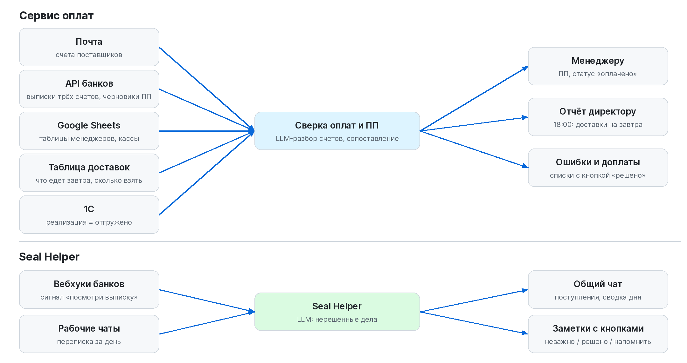
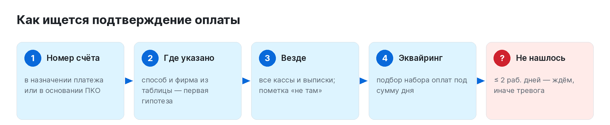
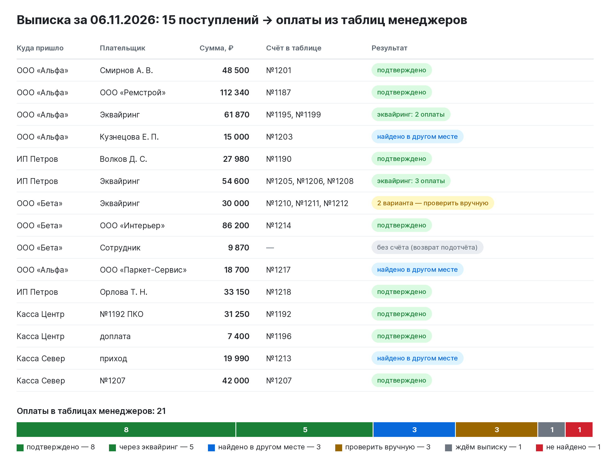
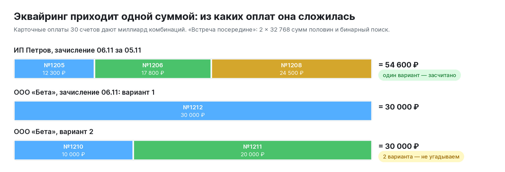
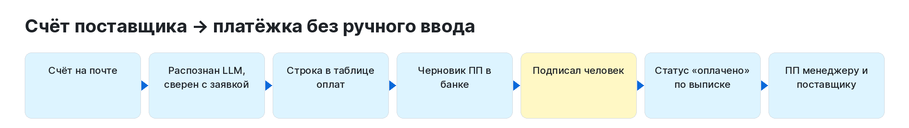
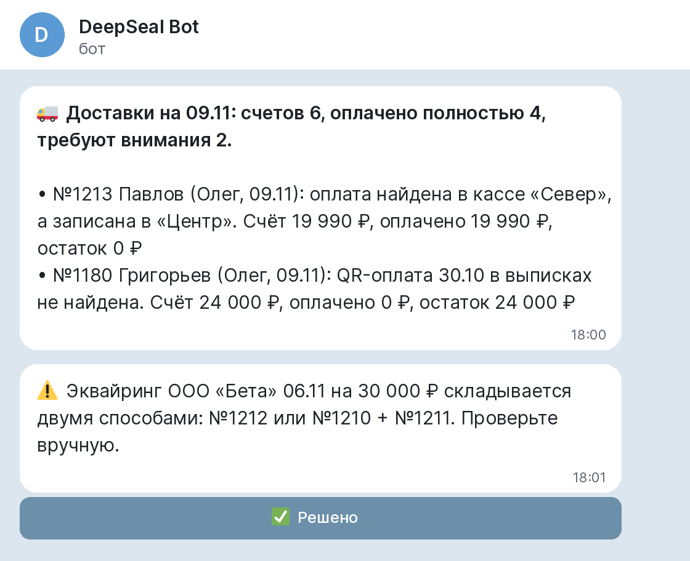
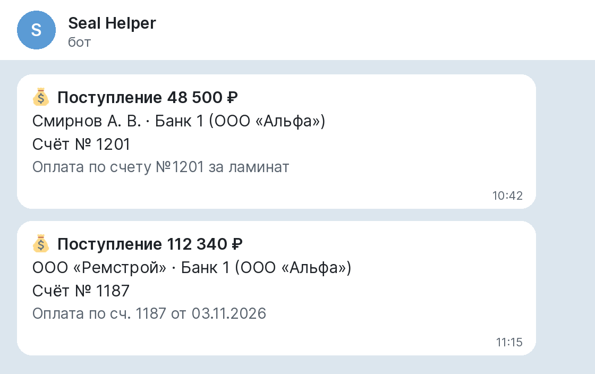
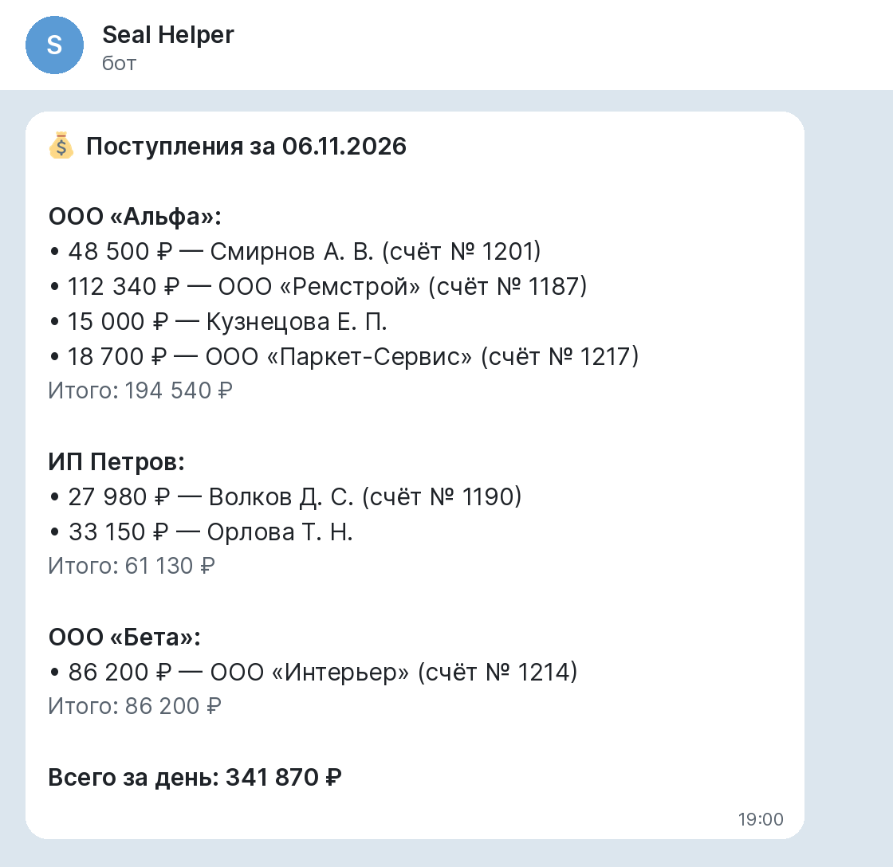
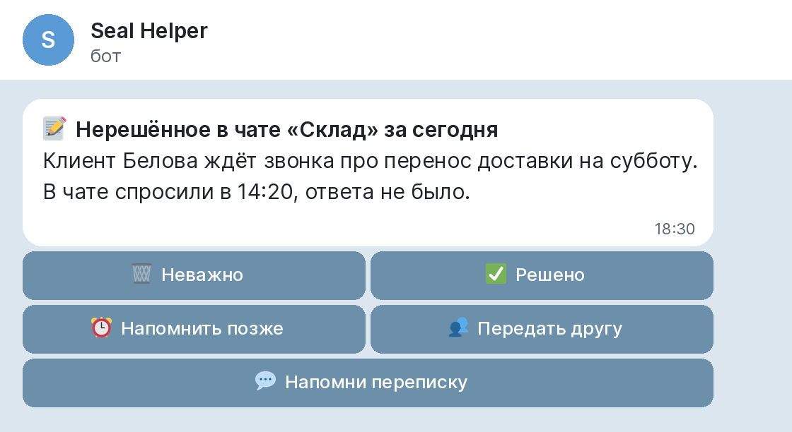

# Payment & Shipment Control + Seal Helper

**[Русская версия](README.md)**

Two internal services of an online flooring store that take manual money reconciliation off the accountant and the director.

- **Payment service** turns supplier invoices into payment orders without manual entry and checks every day the client payments that managers record in their sheets against statements of three bank accounts, shop cash desks, deliveries and 1C (a Russian ERP). Before shipping it is clear whether an invoice is fully paid, and if not, where the gap is.
- **Seal Helper** is the team bot: it reports incoming payments, sends a daily money summary and finds unresolved issues in work chats every evening.

> **This is a project description.** The production code is private (bank integrations, company data). This repository contains a standalone payment-matching module ([`src/paymatch`](src/paymatch)) with tests and a demo day on fictional data. All companies, clients and amounts in the images are made up.

## Results

| | |
|---|---|
| **₽800k** | of payment discrepancies caught before shipment |
| **~40 payment orders a day** | created and sent automatically |
| **up to 1 hour a day** | of manual reconciliation no longer done by the accountant |

## Architecture



## Payment matching



For each payment in a manager's sheet the service looks for confirmation step by step: invoice number in the payment purpose → where the manager said it was paid → everywhere (flagged "found elsewhere") → card acquiring decomposition → "waiting" for fresh payments or an alert.



Card acquiring arrives as one daily sum covering several invoices. Brute force over 30 payments is a billion combinations, so the module uses meet-in-the-middle: sums of two halves (32,768 each) and binary search. If a sum can be composed in more than one way, the service does not guess — it asks for a manual check.



## Supplier payment orders



An LLM (DeepSeek) extracts invoice number, date, total and lines from the supplier's email; plain code checks them against the manager's order. A **draft** payment order is created in the bank after checks (amount, VAT, not paid yet, no duplicate); a human signs it. After execution the status is set from the bank statement and the order is sent to the manager with a "Send to supplier" button. Manager comments like "pay minus 5,087.50" are parsed by rules, ambiguous ones go to the director as a question.

## Before shipping

Every evening at 18:00 tomorrow's deliveries are checked: is each invoice fully paid, how much should the driver collect. Past months are re-scanned for retroactive edits ("before → after"). Errors and underpayments are kept in lists with a "resolved" button.



## Seal Helper

| Incoming payments | Daily summary | Unresolved in chats |
|---|---|---|
|  |  |  |

A bank webhook is only a signal to fetch the statement; the bot then posts who paid how much for which invoice and sends one summary per day. An LLM reads the day's work chats and extracts issues nobody answered, each with "Not important / Done / Remind later / Pass to a colleague / Show the thread" buttons. Works in Telegram or Max.

## Design decisions

- Money moves only through a human: the service creates drafts, people sign.
- No guessing: multiple matches, unclear comments, amount mismatches go to a person with an explanation.
- Rules first, LLM second: the model parses free text; amounts and matching are plain code.
- The stated method is a hypothesis: payments are searched everywhere.
- Snapshots with history make retroactive edits visible.
- Notifications are queued until working hours; failures are reported only if repeated, at most once per 6 hours.

## In this repository

```bash
pip install -r requirements.txt
python examples/demo_day.py
pytest -q   # 11 tests
```

## Stack

Python, Google Sheets API, Gmail API, bank APIs, 1C OData, LLM (DeepSeek), aiogram, Telegram / Max Bot API, SQLite, FastAPI, Docker, pytest, GitHub Actions.

## My role

The project started with a request from management: stop finding payment discrepancies at shipment and take manual reconciliation and payment-order entry off accounting. I analysed how money actually reaches the company (accounts, cash desks, acquiring, drivers), what mistakes managers make in their sheets and how accounting works, defined the checking rules with the director, and designed and rolled out both services. I keep developing them based on feedback from the director and the accountant.

## License

Code in this repository is MIT, see [LICENSE](LICENSE).
