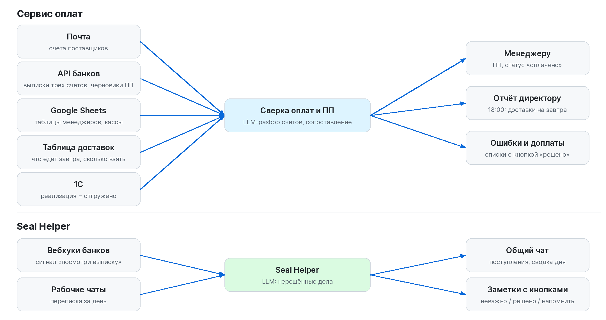
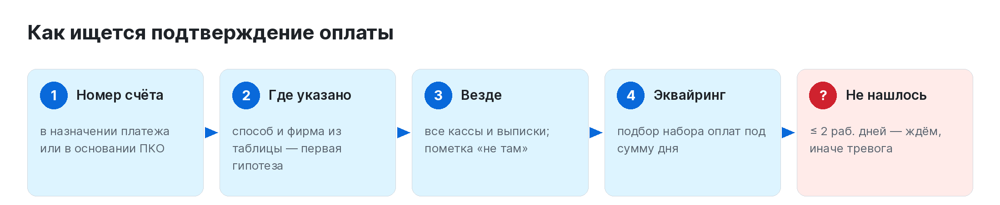
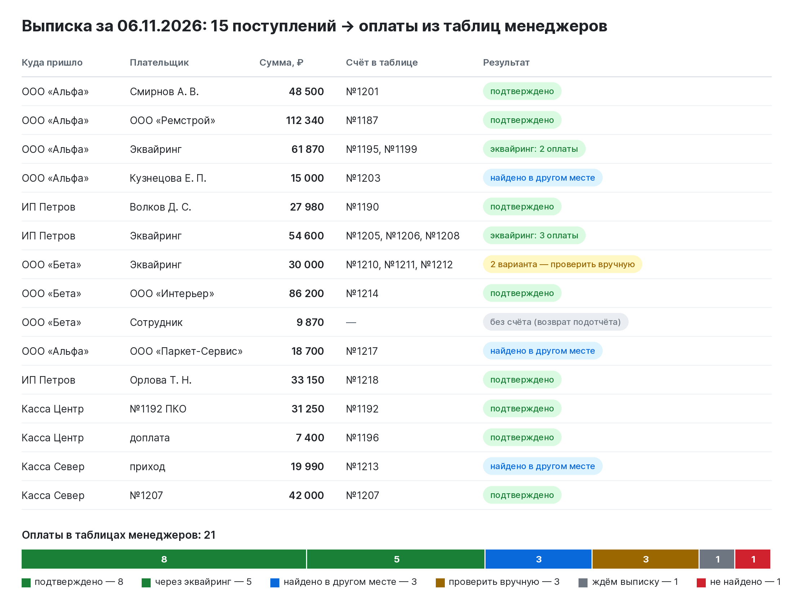
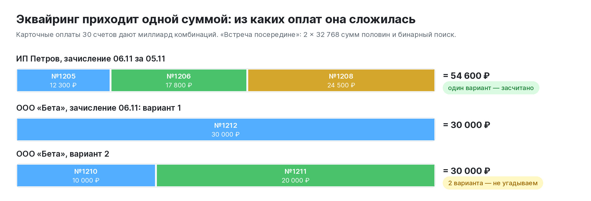
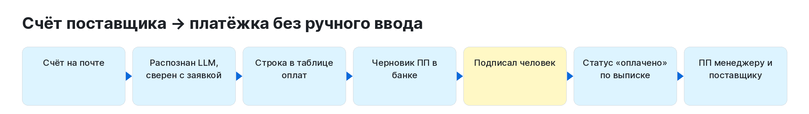
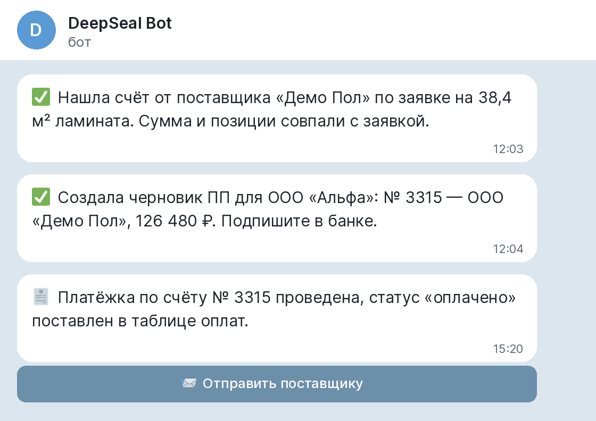
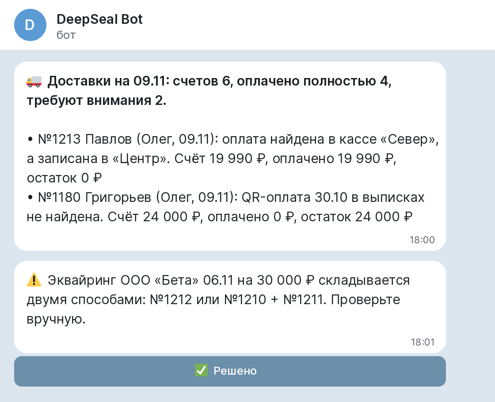
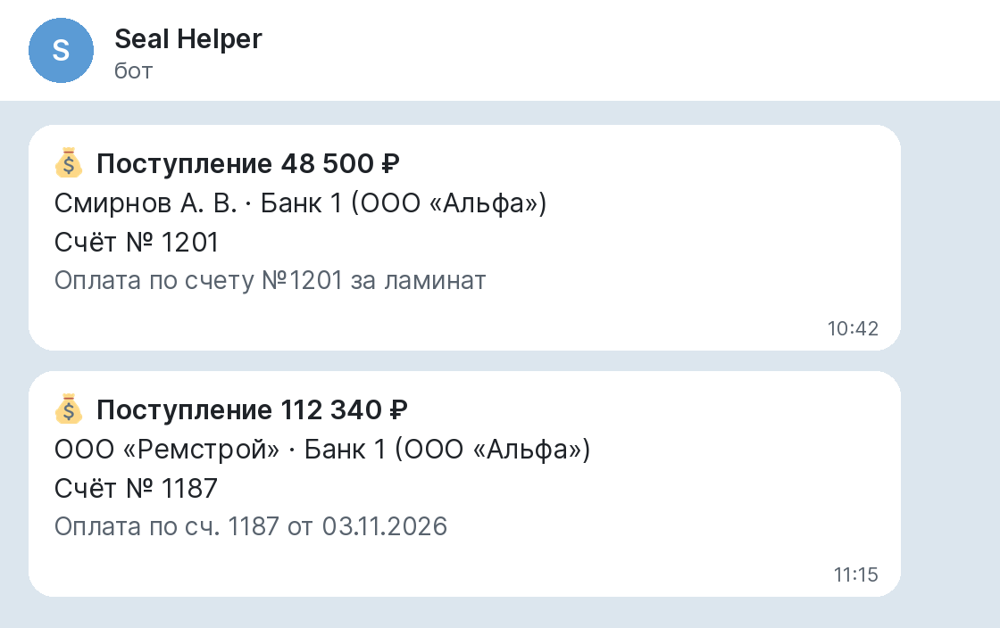
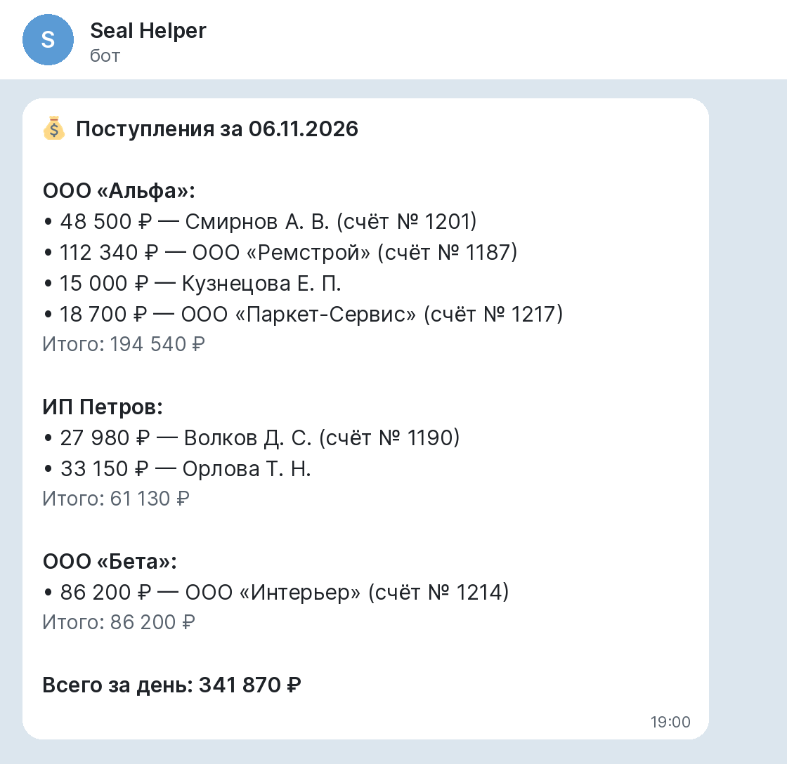
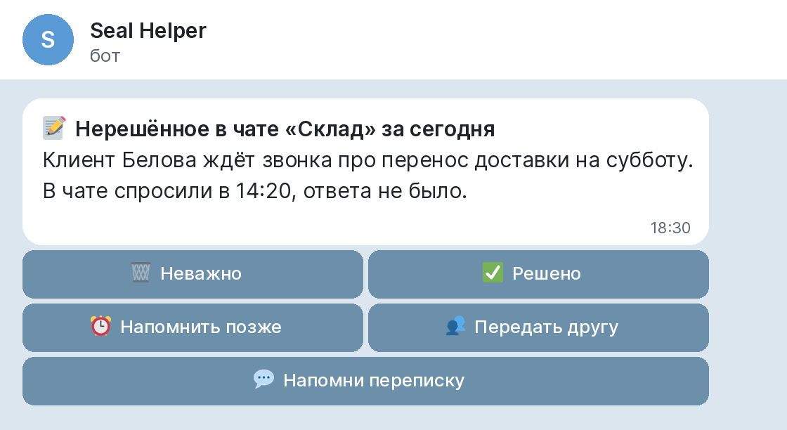

# Контроль оплат и отгрузок + Seal Helper

**[English version](README.en.md)**

Два внутренних сервиса интернет-магазина напольных покрытий, которые снимают с бухгалтерии и директора ручную сверку денег.

- **Сервис оплат** превращает счета поставщиков в платёжные поручения без ручного ввода и каждый день сверяет оплаты клиентов, которые менеджеры записали в таблицы, с выписками трёх банковских счетов, кассами магазинов, доставками и 1С. До отгрузки видно, что счёт оплачен полностью, а если нет — где расхождение.
- **Seal Helper** — бот команды: сообщает о поступлениях на счета, присылает сводку денег за день и по вечерам находит в рабочих чатах нерешённые дела.

> **Это описание проекта.** Код боевых сервисов закрыт: в нём интеграции с банками и данные компании. Здесь выложен самостоятельный модуль сопоставления платежей ([`src/paymatch`](src/paymatch)) с тестами и демо-днём на вымышленных данных. Все фирмы, клиенты и суммы на картинках выдуманы.


## Результат

| | |
|---|---|
| **800 тыс. ₽** | расхождений в оплатах найдено до отгрузки за время работы сервиса |
| **~40 ПП в день** | создаются и отправляются автоматически |
| **до 1 часа в день** | больше не уходит у бухгалтера на ручную сверку |

## Задача

- Менеджеры записывают оплаты клиентов в свои Google-таблицы: сумма, дата, способ («нал», «карта», «QR на ИП», «безнал»). Деньги при этом приходят в разные места: три расчётных счёта, кассы двух магазинов, водителю при доставке.
- Карточные оплаты банк зачисляет одной суммой за день, а после выходных — пачкой. Сопоставить такую сумму со счетами вручную долго.
- Менеджер может ошибиться со способом или фирмой, а цифры в таблице иногда правят задним числом.
- Счета поставщиков приходят на почту. Бухгалтер вручную набивает по каждому платёжку, потом проставляет статус и пересылает ПП менеджеру.
- Итог: расхождения находились при отгрузке, когда товар уже у водителя.

## Как устроено



## Сопоставление оплат



Для каждой оплаты из таблицы менеджера сервис ищет подтверждение по шагам:

1. **Номер счёта** в назначении платежа или в основании приходного ордера плюс сумма.
2. **Там, где указал менеджер:** способ и фирма из таблицы — только первая гипотеза.
3. **Везде:** все кассы и выписки. Нашлось не там — оплата засчитывается с пометкой «найдено не там, где указано», это информация, а не ошибка.
4. **Эквайринг:** какой набор карточных оплат даёт сумму зачисления.
5. **Не нашлось:** свежая оплата (до 2 рабочих дней) — «ждём», старше — тревога.

### Демо: выписка за один день

15 поступлений за 06.11.2026 на трёх счетах и в двух кассах и 21 оплата из таблиц менеджеров ([`examples/demo_day.py`](examples/demo_day.py)):



### Эквайринг: из чего сложилась сумма

Зачисление по картам — одна сумма за день. За ней могут стоять оплаты нескольких менеджеров. Перебор всех комбинаций для 30 оплат — миллиард вариантов, поэтому используется «встреча посередине»: суммы двух половин (по 32 768) и бинарный поиск ([`subset.py`](src/paymatch/subset.py)). Если сумма складывается несколькими способами, сервис не угадывает, а просит проверить вручную.



## Платёжки поставщикам



- Счёт поставщика приходит на почту. LLM (DeepSeek) извлекает номер, дату, итог и позиции, а обычный код сверяет их с заявкой менеджера: количество в м², упаковках и штуках, цены.
- По строке в таблице оплат в банке создаётся **черновик** ПП. Перед этим — проверки: сумма совпадает со счётом, есть НДС, счёт ещё не оплачен, дубля нет. Не прошла проверка — ПП не создаётся, директор получает пояснение.
- Комментарии менеджера вроде «оплатить за минусом 5 087,50» или «срочно» разбираются правилами, сложные формулировки — LLM. Неоднозначное не угадывается, а уходит директору вопросом.
- Подписывает ПП человек. После проведения сервис по выписке ставит в таблице статус «оплачено» (или «оплачено 95 000 р», если платили частично) и присылает ПП менеджеру с кнопкой «Отправить поставщику».
- Если строку уже оплаченного в банке счёта изменили, директору приходит предупреждение, что старая ПП неактуальна.
- Регулярные счета (аренда образцов, коммунальные услуги, интернет) сервис сам ищет на почте раз в месяц и готовит по ним ПП.



## Контроль перед отгрузкой

- Каждый вечер в 18:00 сервис обновляет данные и проверяет доставки на завтра: оплачен ли каждый счёт полностью, сколько взять водителю. Отчёт приходит директору.
- Обход прошлых месяцев: если в таблице задним числом поменяли сумму счёта, оплаты, скидку или способ оплаты, директор видит «было → стало». Отгруженные счета — сверху.
- Ошибки и недоплаты собираются в списки с кнопкой «решено» — в боте и в Google-таблице.
- Отгружено — только два признака: счёт был в доставках или в 1С проведена реализация.



## Seal Helper

| Поступления | Сводка дня | Нерешённое в чатах |
|---|---|---|
|  |  |  |

- **Поступления.** Вебхук банка — только сигнал «посмотри выписку»: тело не разбирается, сервис сам запрашивает выписку и пишет в общий чат, кто и сколько заплатил и по какому счёту. Эквайринг и внутренние переводы не засоряют чат. Вечером — одна сводка за день по счетам.
- **Нерешённое в чатах.** LLM читает переписку рабочих чатов за день и выделяет дела, на которые никто не ответил. Каждая заметка приходит с кнопками: «Неважно», «Решено», «Напомнить позже», «Передать другу», «Напомни переписку».
- **Telegram или Max.** Уведомления уходят туда, где работает команда; переключатель у владельца.
- Утром — пожелание, вечером — анекдот: мелочь, но команда читает чат охотнее.

## Почему так устроено

- **Деньги — только через человека.** Сервис создаёт черновики ПП, подписывает бухгалтер или директор.
- **Не угадываем.** Несколько вариантов сопоставления, неясный комментарий, несовпадение суммы — вопрос человеку с пояснением, а не «наиболее вероятный» ответ.
- **Сначала правила, потом LLM.** Нейросеть разбирает только то, что правилами не разобрать: текст счёта, свободные комментарии, переписку. Суммы и сверку считает обычный код.
- **Указанное — гипотеза.** Способ и фирма из таблицы проверяются первыми, но платёж ищется везде: ошибка менеджера в способе оплаты не делает оплату «потерянной».
- **Срез с историей.** Таблицы, кассы и выписки сохраняются в собственную базу с отслеживанием изменений, поэтому видно, что правили задним числом.
- **Не будить людей.** Уведомления копятся в очереди и уходят в рабочее время; о сбоях сервис пишет владельцу, только если сбой повторился, и не чаще раза в 6 часов.

## Что в этом репозитории

| Путь | Что это |
|---|---|
| [`src/paymatch/subset.py`](src/paymatch/subset.py) | Подбор набора платежей под сумму: «встреча посередине», все варианты для проверки неоднозначности |
| [`src/paymatch/matcher.py`](src/paymatch/matcher.py) | Сопоставление оплат с поступлениями: номер счёта → где указано → везде → эквайринг → ждём/тревога |
| [`examples/demo_day.py`](examples/demo_day.py) | Демо-день: 15 поступлений и 21 оплата, вымышленные данные |
| [`tests/`](tests) | 11 тестов (pytest, GitHub Actions) |

```bash
pip install -r requirements.txt
python examples/demo_day.py
pytest -q
```

## Стек

Python, Google Sheets API, Gmail API, API банков, 1С OData, LLM (DeepSeek), aiogram, Telegram / Max Bot API, SQLite, FastAPI, Docker, pytest, GitHub Actions.

## Моя роль

Проект вырос из запроса руководства: перестать находить расхождения в оплатах при отгрузке и снять с бухгалтерии ручную сверку и набивку платёжек. Я разобрал, как деньги на самом деле приходят в компанию (счета, кассы, эквайринг, водители), какие ошибки делают менеджеры в таблицах и как работает бухгалтерия, сформулировал правила проверки вместе с директором, спроектировал и внедрил оба сервиса. Сейчас развиваю их по обратной связи директора и бухгалтера.

## Лицензия

Код в этом репозитории — MIT, см. [LICENSE](LICENSE).
